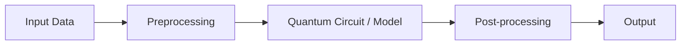

<div align="center">

# Qubits Infernova

**VTU-QFF-HC-0094** &nbsp;|&nbsp; Tier: **Both**

</div>

---

<div align="center">

| | |
| :--- | :--- |
| **Team** | Qubits Infernova |
| **Team ID** | VTU-QFF-HC-0094 |
| **Tier** | Both |
| **Repository** | [vtu-hc-qubits-infernova](https://github.com/vtu-qiskit-fall-fest-2026/vtu-hc-qubits-infernova.git) |
| **Organisation** | [vtu-qiskit-fall-fest-2026](https://github.com/vtu-qiskit-fall-fest-2026) |
| **Event** | VTU-QFF Hackathon — VTU-Qiskit Fall Fest 2026 |

</div>

---

## 📌 Table of Contents

- [Team Members](#-team-members-github-ids)
- [Problem Statement](#-problem-statement)
- [Proposed Solution](#-proposed-solution)
- [Approach & Architecture](#-approach--architecture)
- [Tech Stack](#-tech-stack)
- [Project Structure](#-project-structure)
- [How to Run](#-how-to-run)
- [How to Push Code](#-how-to-push-code)
- [Submission Checklist](#-submission-checklist)
- [Resources](#-resources)
- [License](#-license)

---

## 👥 Team Members (GitHub IDs)

> Members are added to this repository as **collaborators** and must accept the
> GitHub invitation before they can push. Add your GitHub username below.

| # | Name | GitHub Username | Role |
| :-- | :--- | :--- | :--- |
| 1 | Harshavardhaan S | sharshavardhaan05-rgb | _Team Lead_ |
| 2 | Garima Mishra V | garimamishrav2007-cmd | _Developer_ |
| 3 | Ameerkhan S | ameerkhan2732-cpu | _Developer_ |

<!--
Optional: add a plain list instead of the table above.
- @username1
- @username2
-->

---

## ❓ Problem Statement

<!--

-->

**Problem:** A secure chat prototype that uses quantum keys and tells noise apart from eavesdropping on real-world links.

**Why it matters:** _IMPACT AND OPPORTUNITY

Impact
Adversaries are recording encrypted defence, government and journalist communications today to decrypt them once quantum computers mature. Sensitive messages often need to stay secret for decades, and a message cracked later cannot be protected again. QuantaGuard Chat gives these users keys generated with quantum key distribution (BB84), whose security rests on quantum physics rather than on encryption math that future computers may break.

The gap we address
Real field links (fibre, satellite, tactical radio) are noisy, so a rising error rate could mean a weak link or an eavesdropper. Our Channel Trust Meter reads the quantum bit error rate and classifies the channel as safe, noisy but usable, or compromised. Noise shortens the key, and a detected attack discards the key and blocks messaging, so the link is neither blindly trusted nor wrongly abandoned.

Opportunity
1. Training and awareness: defence teams and students can see how noise and attacks change the error rate, key length and chat availability without lab equipment.
2. Link assessment: teams can judge whether a channel is fit for QKD before investing in hardware.
3. Foundation for growth: the same decision logic can sit on top of real QKD key feeds in future.
4. Accessibility: built on Qiskit and open tools, so universities and small labs can use and extend it.

Scope
QuantaGuard Chat is a prototype validated on Qiskit Aer, IBM noise models and an IBM hardware run. It demonstrates the approach and does not replace commercial QKD hardware._

**Track / Category:** _Online / Offline · Track 1 / Track 2 · <domain>_

---

## 💡 Proposed Solution

<!--
Describe your solution. Keep it concrete: the core idea, the user flow, and
the quantum/ML technique you are applying.
-->

**Solution:** QuantaGuard Chat is a Qiskit-based secure chat that generates encryption keys with the BB84 quantum protocol, simulates real-world noise using Aer and IBM backends, and uses a Channel Trust Meter to classify the link as safe, noisy but usable, or compromised.
Noise automatically shortens the key, and a detected eavesdropper discards the key and blocks the chat, so messages stay protected even on imperfect field links.

**Key idea:** A quantum-key secure chat that tells channel noise apart from eavesdropping, and automatically shortens the key or blocks messaging to keep communication safe on noisy real-world links.

**Why this works:** HOW OUR APPROACH ADDRESSES THE PROBLEM STATEMENT

Problem: Encrypted defence, government and journalist traffic is being recorded today to be decrypted once quantum computers mature, and real QKD links are too noisy for operators to tell a weak channel from an eavesdropper.

1. Long-term secrecy: Keys are generated with the BB84 quantum protocol in Qiskit, so their security rests on quantum physics rather than on encryption math that future computers may break.

2. Eavesdropper detection: Alice and Bob sift their results on matching bases and sample part of the key to measure the quantum bit error rate (QBER). An intercept-resend attack raises QBER to about 25%, well above the ~11% BB84 safety limit.

3. Noise handling: Aer noise models and IBM fake-backend profiles simulate real channel imperfections, and a batch is validated on real IBM hardware. This shows how ordinary noise differs from an attack in the measured results.

4. Automatic decision: The Channel Trust Meter classifies the link as safe, noisy but usable, or compromised, so operators get a clear verdict rather than a raw error number.

5. Adaptive protection: In the usable range, error correction and privacy amplification shorten the key to a secure length. Above the threshold, the key is discarded and messaging is blocked.

6. End-to-end result: The final key encrypts messages in a working Streamlit chat, so the full path from quantum key exchange to protected communication can be demonstrated live.

---

## 🧩 Approach & Architecture

<!--
Walk through how it works. A simple pipeline diagram in text or Mermaid is ideal.
-->



1. **Input** — _what data goes in and in what format_
2. **Preprocessing** — _cleaning, feature extraction, encoding_
3. **Quantum core** — _the circuit, ansatz, or algorithm used_
4. **Post-processing** — _decoding, measurement, scoring_
5. **Output** — _what the user finally gets_

---

## 🛠️ Tech Stack

| Layer | Technology |
| :--- | :--- |
| Language | Python 3.11+ |
| Quantum SDK | Qiskit `>=1.0`, Qiskit Aer, Qiskit Runtime |
| Optimisation | Qiskit Optimization / COBYLA / SPSA |
| Simulation | AerSimulator (statevector / noisemodel) |
| Environment | JupyterLab / VS Code, `venv` |
| Version control | Git + GitHub |

---

## 📁 Project Structure

```text
vtu-hc-qubits-infernova/
├── README.md              # This file
├── requirements.txt       # Python dependencies
├── pyproject.toml         # Project metadata (optional)
├── .gitignore
├── notebooks/             # Jupyter notebooks for experiments
│   └── exploration.ipynb
├── src/
│   ├── __init__.py
│   ├── circuit.py         # Quantum circuit construction
│   ├── optimizer.py       # Optimization loop
│   └── main.py            # Entry point
├── data/                  # Datasets (use Git LFS for large files)
├── tests/                 # Unit tests
│   └── test_circuit.py
└── docs/                  # Notes, diagrams, reports
```

---

## 🚀 How to Run

### Prerequisites

- Python 3.11 or newer
- [Git](https://git-scm.com/downloads)
- A GitHub account (you need collaborator access to this repo)

### 1. Clone the repository

```bash
git clone https://github.com/vtu-qiskit-fall-fest-2026/vtu-hc-qubits-infernova.git
cd vtu-hc-qubits-infernova
```

### 2. Create a virtual environment

```bash
python3 -m venv .venv
source .venv/bin/activate        # Linux / macOS
# .venv\Scripts\activate         # Windows (PowerShell)
```

### 3. Install dependencies

```bash
pip install --upgrade pip
pip install -r requirements.txt
```

### 4. Run

```bash
python -m src.main
```

Or launch the notebook workflow:

```bash
jupyter lab
```

### 5. Run the tests

```bash
pytest -q
```

---

## 🔁 How to Push Code

> Full walkthrough: **[Git & Collaboration Handbook](../vtu-hc-guide-git-and-collaboration)** — collaboration
> workflow, branches, pull requests, reviews and conflict resolution.

### Configure Git (first time only)

```bash
git config --global user.name  "Your Name"
git config --global user.email "you@example.com"
```

### Everyday workflow

```bash
# 1. Get the latest changes
git checkout main
git pull origin main

# 2. Create a branch for your work
git checkout -b feature/my-task

# 3. Commit your work
git add .
git commit -m "feat: add variational circuit for the search problem"

# 4. Push the branch
git push -u origin feature/my-task

# 5. Open a Pull Request on GitHub and request a review
#    https://github.com/vtu-qiskit-fall-fest-2026/vtu-hc-qubits-infernova/compare/main...feature/my-task

# 6. After approval, merge into main
git checkout main
git pull origin main
git branch -d feature/my-task
```

### Commit message convention

| Prefix | Meaning |
| :--- | :--- |
| `feat:` | New feature |
| `fix:` | Bug fix |
| `docs:` | Documentation only |
| `test:` | Adding or fixing tests |
| `refactor:` | Code restructure, no behaviour change |
| `chore:` | Build/config/dependency changes |

### Useful commands

```bash
git status              # what changed
git log --oneline -10   # recent commits
git diff                # review changes before committing
git stash               # shelve changes temporarily
git pull --rebase       # update your branch on top of main
```

### Collaborating on the same repo

- **Never push directly to `main`** — open a Pull Request.
- **Pull before you push** to avoid rejected commits.
- **Commit often** with clear messages.
- **Resolve conflicts** locally: `git pull --rebase`, fix the files, then `git add` + `git rebase --continue`.
- **Ask for a review** before merging — a second pair of eyes catches bugs fast.

---

## ✅ Submission Checklist

- [ ] Repository created and **public**
- [ ] All team members added as **collaborators** and invitations accepted
- [ ] `README.md` updated with project details, problem statement and solution
- [ ] Team members listed under [Team Members](#-team-members-github-ids)
- [ ] `requirements.txt` committed and project runs from a clean clone
- [ ] Code pushed to `main` and the latest `main` builds successfully
- [ ] Notebooks committed with **cleared outputs** (or use `nbstrip`)
- [ ] `README` includes a demo screenshot / video link
- [ ] Short project summary submitted on the hackathon portal

---

## 📚 Resources

| Resource | Link |
| :--- | :--- |
| 🔁 Git & collaboration handbook | [Git & Collaboration Handbook](../vtu-hc-guide-git-and-collaboration) |
| ❓ Problem statements, solutions & terms | [Problem Statements, Solutions & Terms](../vtu-hc-guide-problem-and-solution) |
| 📄 README writing guide | [README Guide & Template](../vtu-hc-guide-readme-template) |
| ⚛️ Qiskit documentation | https://docs.quantum.ibm.com/ |
| ⚛️ Qiskit Runtime & primitives | https://quantum.cloud.ibm.com/docs/ |
| 🧪 Qiskit Aer simulator | https://docs.quantum.ibm.com/guides/simulator |
| 💻 IBM Quantum Platform | https://quantum.cloud.ibm.com/ |
| 🎓 Qiskit textbook | https://qiskit.qotlabs.org/learning/ |
| 📋 GitHub Docs | https://docs.github.com/ |

---

## 📄 License

Released under the [MIT License](LICENSE). See `LICENSE` for details.

---

<div align="center">

**Qubits Infernova** · Team ID `VTU-QFF-HC-0094` · Tier `Both`
· Built with ⚛️ Qiskit for the VTU-QFF Hackathon

[⬆ Back to Top](#qubits-infernova)

</div>
